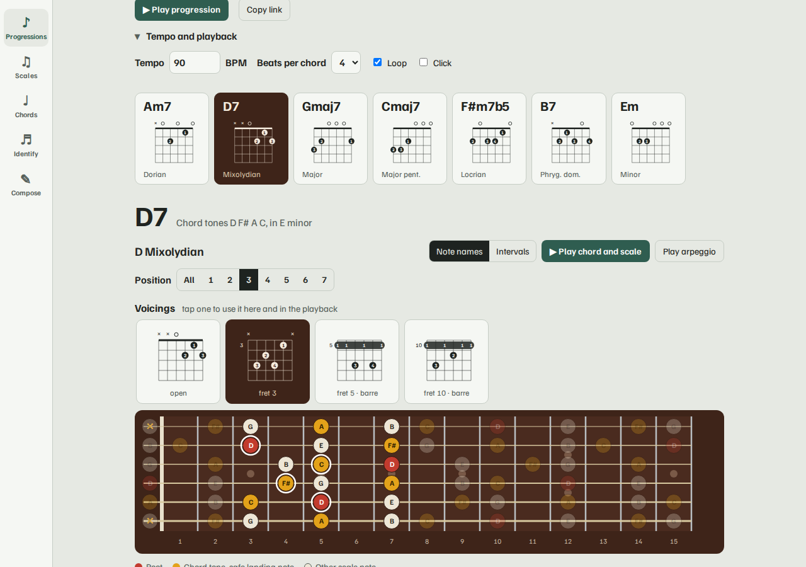
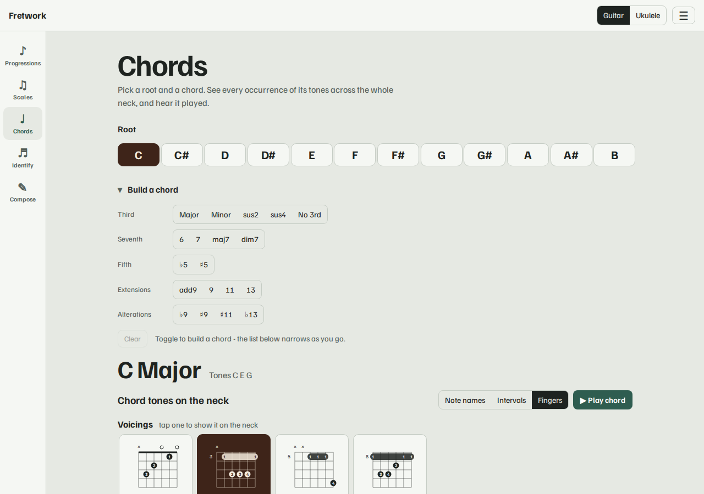
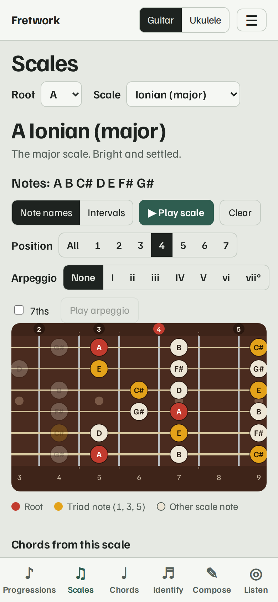

# Fretwork

Scales, chords and chord progressions on the fretboard, for guitar and ukulele.
A small installable web app that works offline - vanilla JavaScript, no framework,
no build step, no accounts, no tracking.

[](https://github.com/junousia/fretwork/actions/workflows/ci.yml)
[](https://junousia.github.io/fretwork/)
[](LICENSE)

**Live:** https://junousia.github.io/fretwork/



## What it does

- **Progressions** - type a chord progression (or pick a common one and transpose it to any
  key). Each chord gets the scales that fit it, ranked for the detected key, laid out on the neck
  with chord tones and safe landing notes marked. **Play it** with the chosen voicings (tempo,
  beats per chord, loop, click) and watch the neck follow, or **copy a link** that opens the same
  progression, scale positions and voicings for someone else.
- **Scale positions** - pick any scale and root, then isolate one of its positions (or several).
  Pentatonic scales use the classic CAGED boxes; seven-note scales use one-finger-per-fret
  positions in the style of the Berklee/Leavitt system. Every position reads as an unbroken run
  of the scale - no skipped notes.
- **Chord voicings** - real fingerings (about 1,600 for guitar and for ukulele) with finger
  numbers and barres, shown next to each chord and ringed on the neck. Picking a voicing moves
  the scale position to match, and "Play" strums the actual fretted notes.
- **Chord identifier** - mark notes on the fretboard (click frets, or pick a fret per string) and
  get every chord that fits, best first, with slash chords and any omitted tones ("without the
  5th"); play it, or open a match in the Chords tab.
- **Tab editor** - write a riff or solo as tab: click a spot, type the fret, pick note lengths
  (1/16 to a whole note, dotted too), name a chord per bar, undo/redo. It plays back with the bar
  chords and a click, keeps a separate tab per instrument, saves in the browser, and copies as plain
  ASCII tab. Chords can sit anywhere in a bar and are gathered at the top with fingerings. A **solo
  generator** writes a melodic line over the chords (follow the chords, pentatonic or blues).
- **Arpeggios** - on any seven-note scale pick a chord stacked on a degree (I, ii ... vii, with
  optional 7ths) and see its arpeggio inside the chosen position; on a chord fingering, switch on the
  *arpeggio shape* to see every chord tone in its fret window. Both can be played.
- **Chord builder** - toggle minor, 7, maj7, sus4, 9, b5 ... and the chord list narrows to what
  matches; impossible combinations are greyed out.
- **Guitar and ukulele** with 14 tunings (drop D, DADGAD, open G/D/E, half/whole step down,
  7-string, low-G, baritone ...), a **capo** and a **left-handed** (mirrored) neck. Chord shapes are
  reused wherever they are really valid in the chosen tuning. Labelled by note name, interval or
  finger, with audio playback.
- **Installable and offline** (PWA), responsive from phone to desktop.

| Chords | Scales on a phone |
| --- | --- |
|  |  |

## Run it

No dependencies are needed to use it - it is static files in `site/`:

```sh
node tools/serve.mjs        # http://localhost:8000
BASE=/fretwork node tools/serve.mjs 8001   # under a subpath, like GitHub Pages
```

or `docker build -t fretwork . && docker run -p 8000:8000 fretwork`.

## Develop

```sh
npm install                       # only needed for the browser test (Playwright)
npm run typecheck                 # TypeScript over the JSDoc types (no build step)
npm test                          # theory, arpeggios, tunings, SVG goldens, shipped site (plain Node, fast)
npx playwright install chromium   # once
npm run test:e2e                  # real-browser smoke test incl. offline + subpath
npm run test:a11y                 # axe accessibility (light/dark, desktop/phone) + PWA installability
npm run test:golden:update        # after an intentional visual change: regenerate, then review the diff
```

Everything lives in `site/` as ES modules; there is nothing to compile (types are JSDoc, checked by `tsc --noEmit`). See
[AGENTS.md](AGENTS.md) for the design notes - especially how scale positions and chord voicings
are generated and why - before changing `site/positions.js` or `site/voicings.js`.

Contributions go through pull requests; see [CONTRIBUTING.md](CONTRIBUTING.md).

## Deployment

Merging to `main` runs the tests and publishes `site/` to GitHub Pages
(`.github/workflows/pages.yml`). Everything in the app uses relative paths so it also works under
the `/fretwork/` subpath. The `Dockerfile` serves the same files with nginx for self-hosting.

## Credits and licence

MIT licensed, see [LICENSE](LICENSE). Chord fingerings come from
[tombatossals/chords-db](https://github.com/tombatossals/chords-db) (MIT); the font is Familjen
Grotesk (SIL OFL 1.1). Details in [THIRD_PARTY_NOTICES.md](THIRD_PARTY_NOTICES.md).
