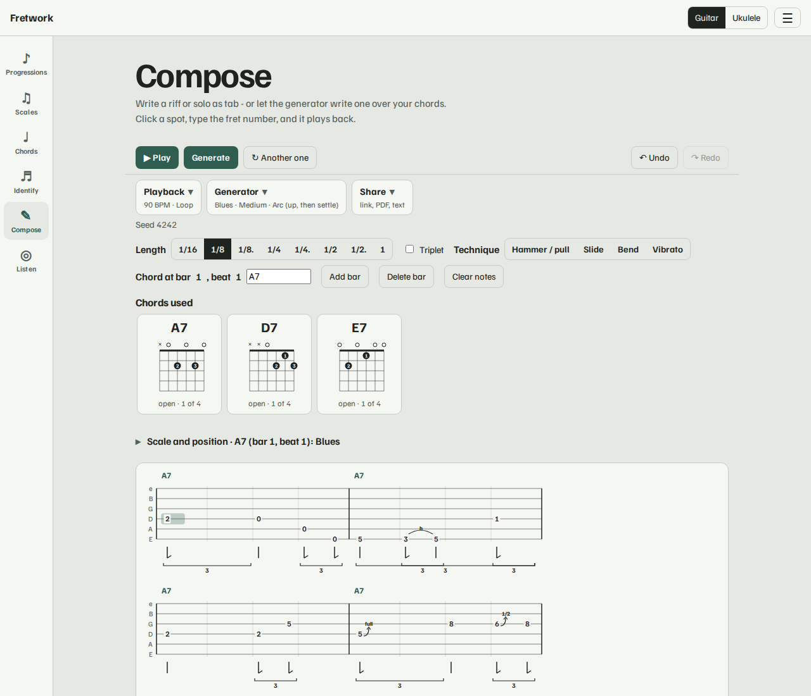
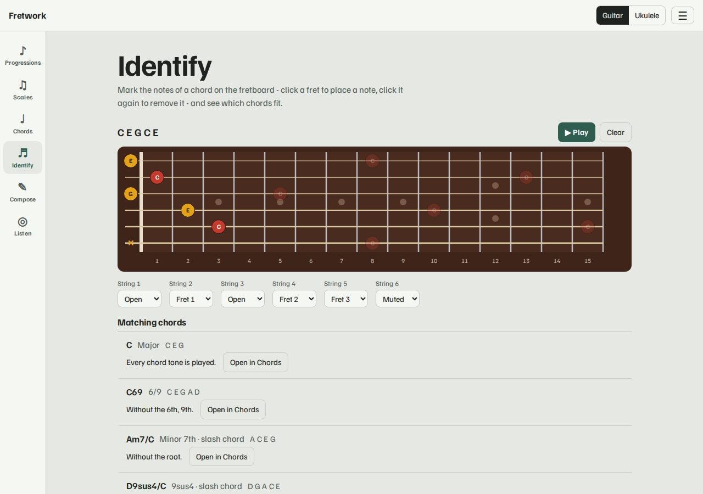
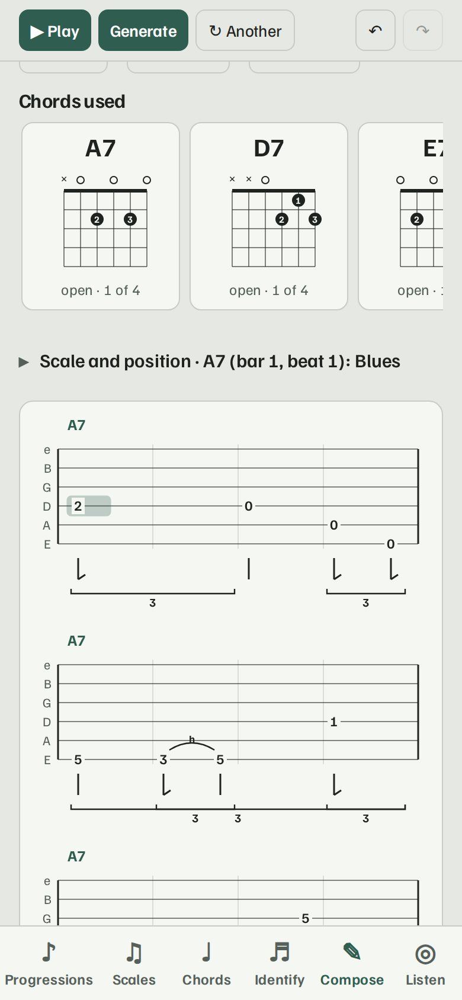
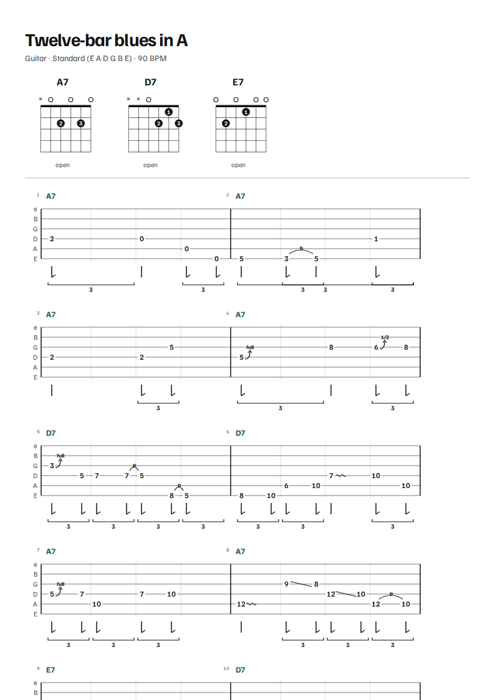

# Fretwork

Scales, chords and solos on the fretboard, for guitar and ukulele - and a composer that writes a
solo over your chords as tab. A small installable web app that works offline: vanilla JavaScript,
no framework, no build step, no accounts, no tracking.

[](https://github.com/junousia/fretwork/actions/workflows/ci.yml)
[](https://junousia.github.io/fretwork/)
[](LICENSE)

**Live:** https://junousia.github.io/fretwork/



## The five pages

| Page | What it is for |
| --- | --- |
| **Progressions** | Type a chord progression, or load one - common progressions, blues, jazz, classics and well-known songs - in any key; repeats like `(Am F)x2` work in the chord box (one Key menu sets the analysis key and transposes what you loaded). Each chord gets the scales that fit it, ranked for the key, laid out on the neck with chord tones and safe landing notes marked. Play it with the voicings you chose - the notes glow on the neck as they sound - or copy a link. |
| **Scales** | Pick a scale and a root, isolate one of its positions, and see its arpeggios inside the position and the chords the scale makes. |
| **Chords** | Pick a root and a chord type, see every voicing (finger numbers, barres) and every chord tone on the neck. A chord builder narrows the list as you toggle minor, 7, maj7, sus4, 9, b5 ... Each chord links to the scales that fit it, and each scale to the chords it makes - the pages open one another. |
| **Identify** | Mark notes on the fretboard and get every chord that fits, best first, with slash chords and omitted tones. |
| **Compose** | Write a riff or solo as tab, or let the generator write one over your chords. Play it with a choice of strumming and picking patterns, print it as a PDF, share it as a link. Type a chord chart with repeats to lay out a song. |
| **Listen** | Play a note on your guitar and see which one it is, how many cents sharp or flat, the open string it is closest to (a tuner), and where on the neck it lives. Uses the microphone, analysed on your device only; single notes, one at a time. |

Everywhere: **guitar and ukulele** with 14 tunings (drop D, DADGAD, open G/D/E, half and whole step down,
7-string, low-G, baritone ...), a **capo** and a **left-handed** (mirrored) neck; chord shapes are reused
wherever they are really valid in the chosen tuning. Labels by note name, interval or finger. A modelled
**plucked-guitar sound** (or a simple synth) in the setup menu. Installable (PWA), responsive from phone
to desktop, accessible (axe-checked), and nothing leaves your device.

| Progressions | Chords |
| --- | --- |
|  |  |

| Identify | Compose |
| --- | --- |
|  |  |

### Scales and positions

Pentatonic scales use the classic CAGED boxes; seven-note scales use one-finger-per-fret positions in the
style of the Berklee / Leavitt system. Every position reads as an unbroken run of the scale - no skipped
notes. On a seven-note scale you can colour the arpeggio of any degree chord (I, ii ... vii, with optional
7ths) inside the position, and on a voicing switch on the *arpeggio shape*.

### Compose

- **Tab editor** - click a spot, type the fret, choose a note length (1/16 to a whole note, dotted, and triplets),
  name chords anywhere in a bar, undo / redo. Hammer-ons, pull-offs, slides, bends and vibrato are drawn and played.
  Keys: arrows move, digits set a fret (two digits for 10 and up), Delete removes, Space plays, Ctrl+Z undoes, h / s / b / v
  set a technique. Every chord you name is gathered at the top with a voicing you can step through.
- **Solo generator** - pick a style (follow the chords, pentatonic, blues), density, feel (straight, shuffle, triplets, funk),
  how the solo evolves (steady, build up, arc), techniques and a key, then press Generate. It plays inside one position
  per chord (or the scale and positions you choose per chord *occurrence*), starts chords on chord tones, moves mostly by
  step, approaches chord changes, and ends on the root. The same seed always gives the same solo.
  Its defaults are calibrated against 435 real jazz solos (the Weimar Jazz Database): interval mix, rhythm, rests, momentum and
  how often chord tones land on the beat (a *Chord tones* setting goes from textbook to free). It is still a practice-phrase
  generator, not a performer - see `AGENTS.md` for the numbers and the limits.
- **Play, print, share** - playback with the bar chords, a click, loop and optional swing; **Export PDF** (title, tuning,
  the chord boxes and the tab in numbered rows) via the print dialog; **Copy link** shares the whole tab with its
  settings and seed; copy as plain-text tab.



## Run it

No dependencies are needed to use it - it is static files in `site/`:

```sh
node tools/serve.mjs        # http://localhost:8000
BASE=/fretwork node tools/serve.mjs 8001   # under a subpath, like GitHub Pages
```

or `docker build -t fretwork . && docker run -p 8000:8000 fretwork`.

## Develop

```sh
npm install                       # only needed for the browser tests (Playwright)
npm run typecheck                 # TypeScript over the JSDoc types (no build step)
npm test                          # theory, tunings, identifier, tab model, solo generator, share links, sound, SVG goldens, shipped site
npx playwright install chromium   # once
npm run test:e2e                  # real-browser test incl. offline + subpath + the audio chain
npm run test:a11y                 # axe accessibility (light/dark, desktop/phone) + PWA installability
npm run test:golden:update        # after an intentional visual change: regenerate, then review the diff
npm run docs:screenshots          # regenerate docs/screenshots/ from the real app
```

Everything lives in `site/` as ES modules; there is nothing to compile (types are JSDoc, checked by `tsc --noEmit`).
See [AGENTS.md](AGENTS.md) for the design notes - especially how scale positions and chord voicings are generated
and why - before changing `site/positions.js` or `site/voicings.js`, and for how the tab model, the solo generator and
the sound work.

Contributions go through pull requests; see [CONTRIBUTING.md](CONTRIBUTING.md). Releases are listed in
[CHANGELOG.md](CHANGELOG.md).

## Deployment

Merging to `main` runs the tests and publishes `site/` to GitHub Pages
(`.github/workflows/pages.yml`). Everything in the app uses relative paths so it also works under
the `/fretwork/` subpath. The `Dockerfile` serves the same files with nginx for self-hosting.

## Credits and licence

MIT licensed, see [LICENSE](LICENSE). Chord voicings come from
[tombatossals/chords-db](https://github.com/tombatossals/chords-db) (MIT); the font is Familjen
Grotesk (SIL OFL 1.1). The plucked-guitar voice is our own code (a Karplus-Strong string model). Details in
[THIRD_PARTY_NOTICES.md](THIRD_PARTY_NOTICES.md).
